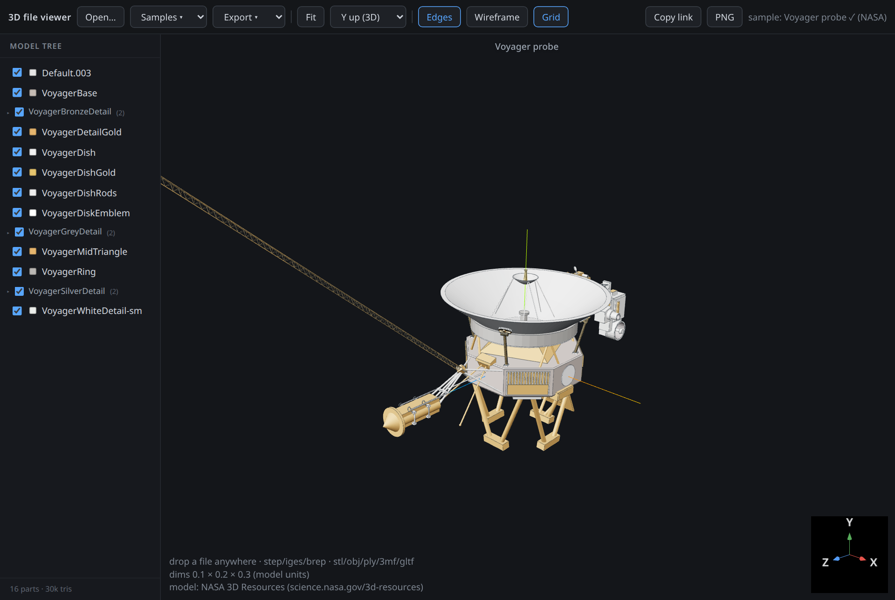
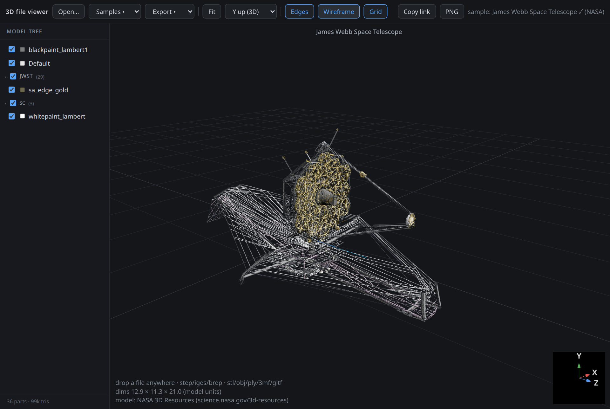

# 3d-file-viewer

This is a simple browser app that lets you view 3D files, and save between a few different formats.  

| Voyager probe | James Webb Space Telescope, wireframe |
|:---:|:---:|
|  |  |

## Formats Supported

You can use this as a 3D format converter by saving a loaded file in another format.

| Format | Load | Save | Notes |
|---|---|---|---|
| STEP (.step/.stp) | yes | | assembly bodies keep their names |
| IGES (.iges/.igs) | yes | | |
| BRep (.brep/.rle) | yes | | |
| STL | yes | yes | binary and ASCII |
| OBJ | yes | yes | |
| PLY | yes | yes | |
| 3MF | yes | | |
| glTF / GLB | yes | GLB | Draco- and Meshopt-compressed too |

B-rep formats are parsed client-side by
[occt-import-js](https://github.com/kovacsv/occt-import-js) (the real
OpenCascade kernel compiled to WebAssembly); the mesh formats use
three.js loaders.
## Using it

- **Open**: the `Open…` button, or drag and drop a file anywhere.
  The `Samples` dropdown has four built-in models to try.
- **Navigate**: left-drag orbits, scroll wheel zooms, right-drag pans.
  `Fit` re-frames the model; the axis dropdown switches Y-up/Z-up.
- **Inspect**: the left tree lists every part, grouped by name prefix;
  expand a group to reach its parts. Checkboxes toggle visibility and
  the swatch recolors a part. `Edges`, `Wireframe`, and `Grid` toggle
  overlays.
- **Share / save**: `Copy link` puts a small model in the URL itself
  (nothing is uploaded), `PNG` saves a screenshot, `Export` downloads
  the model in another format.

## Features

- Orbit / zoom / pan, wireframe, edge overlay, grid toggle
- **Model tree**: docked left sidebar, grouped into a collapsible tree
  by shared name prefixes, with per-part or per-group visibility and
  color swatches (STEP part colors come through)
- **Orientation gizmo**: XYZ triad in the lower-right, tracks the camera
- **Samples**: the Voyager probe (default), the James Webb Space
  Telescope, the Utah teapot, and the Stanford bunny
- **Convert / export**: any loaded model downloads as GLB, STL, OBJ,
  or PLY (drop a STEP, get a glTF)
- **Dims**: bounding-box dimensions in the corner
- **Screenshot**: PNG button
- **Shareable link**: `Copy link` gzips the file and embeds it in the
  URL fragment (`#name.stl;gz=…`). Nothing is uploaded anywhere; the URL
  itself carries the model. Files over ~450 KB get a `?url=` link to a
  hosted copy instead.
- Up-axis toggle: Y-up by default (3D/optics convention), Z-up for CAD.

## Try it live

Drop a STEP, STL, or glTF file onto the page and it opens entirely in your browser. Nothing is uploaded.

Try it here: [3d-file-viewer.pages.dev](https://3d-file-viewer.pages.dev)

## Run it

```bash
python3 -m http.server 8000
# open http://localhost:8000
```

Any static server works. (`file://` works too except the module imports;
serve over HTTP for reliability.)

## Deploy to Cloudflare Pages

The whole folder is the site. Drag it onto a Pages project or point Pages
at a git repo; build command: none, output directory: `/`.

## How it works

`viewer.js` is one ES module. Three.js renders; `OrbitControls` handles
orbit and pan, while wheel and pinch zoom are owned directly
(OrbitControls' zoom is disabled; see
[threejs-lessons.md](https://github.com/jfblanchard/central-planning)
for why). For B-rep formats the file bytes go to
`occt.ReadStepFile()` / `ReadIgesFile` / `ReadBrepFile`, which return
triangulated meshes with part names; each part becomes a
`BufferGeometry`. fflate (gzip) powers the share link.

## Roadmap

- [ ] Measurement on edges/faces, not just surface points
- [ ] Explode view for assemblies
- [ ] OBJ MTL / glTF material passthrough


## Sample model credits

- `samples/jwst.glb`: James Webb Space Telescope, from
  [NASA 3D Resources](https://science.nasa.gov/3d-resources/)
  ([source](https://github.com/nasa/NASA-3D-Resources/tree/master/3D%20Models/James%20Webb%20Space%20Telescope%20%28B%29)).
  Courtesy of NASA; use does not imply NASA endorsement.
- `samples/voyager.glb`: Voyager probe, also from
  [NASA 3D Resources](https://science.nasa.gov/3d-resources/). Same
  terms as above.
- Utah teapot: generated in code via three.js `TeapotGeometry` (Martin
  Newell's public-domain patch data). No file.
- `samples/bunny.ply`: Stanford bunny (`bun_zipper_res2`), from the
  [Stanford 3D Scanning Repository](https://graphics.stanford.edu/data/3Dscanrep/).
  Stanford permits free use with acknowledgment of the Stanford
  University Computer Graphics Laboratory. Unmodified.

The viewer shows the credit for whichever sample is loaded, in the status
line and the lower-left corner.
